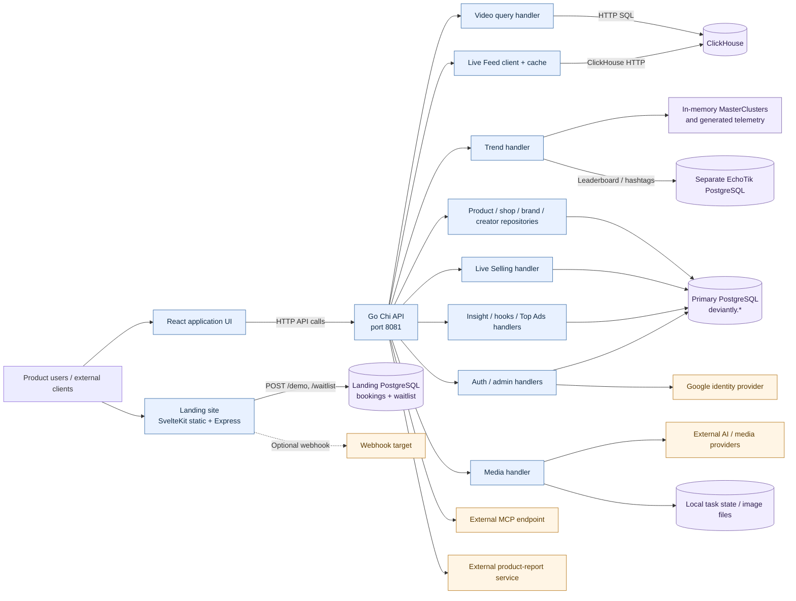
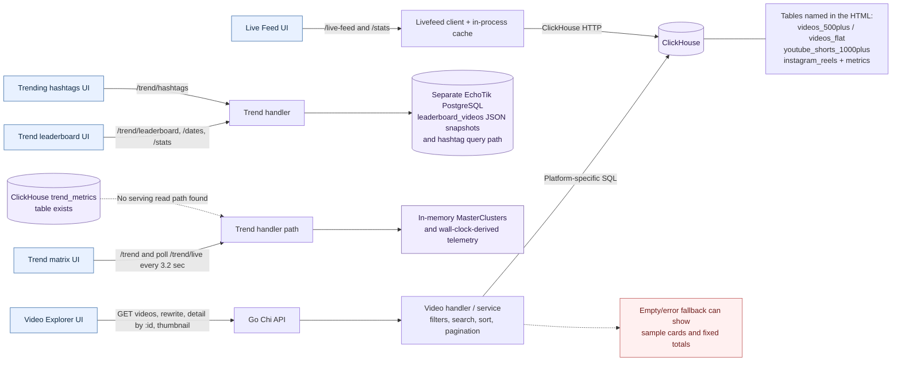
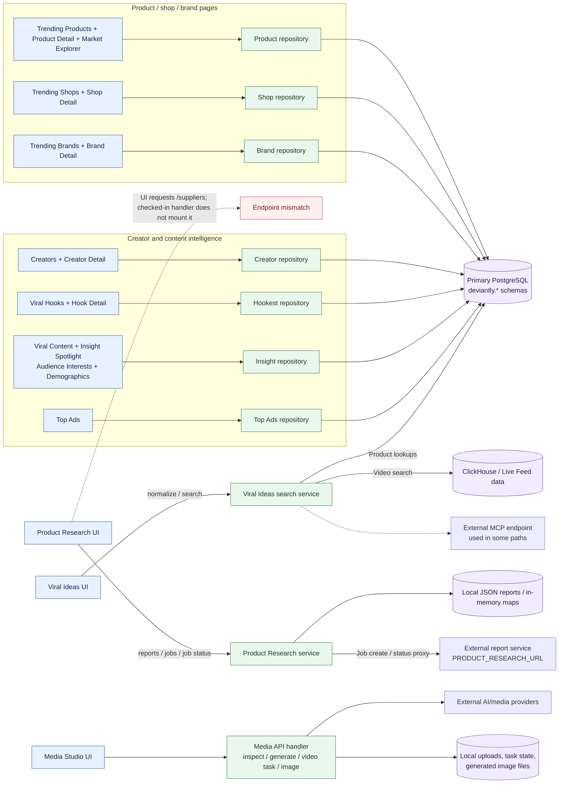
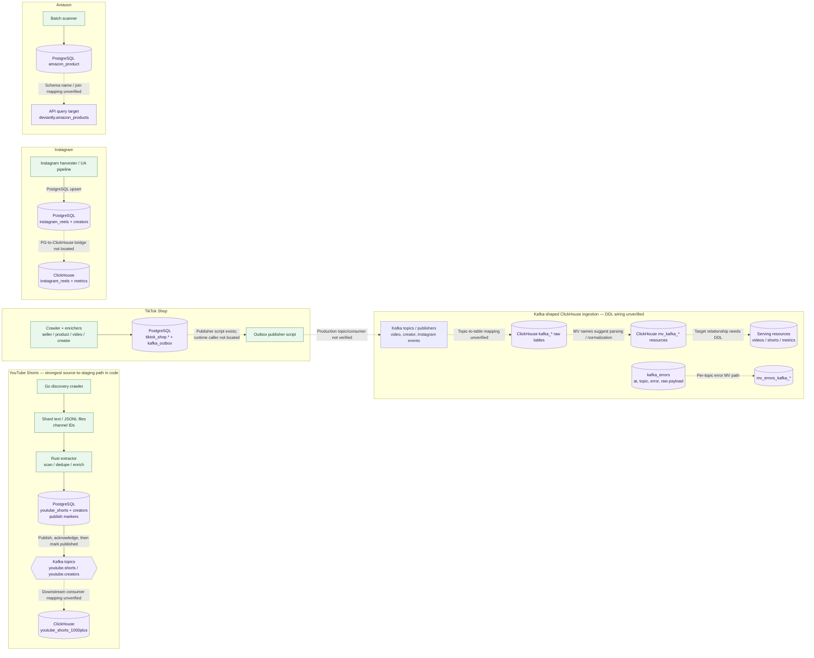
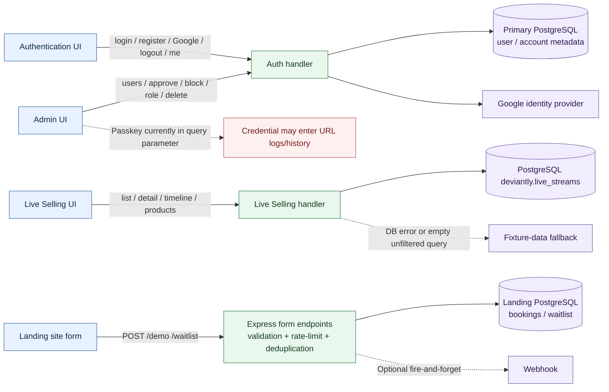

# Deviantly — Mermaid architecture diagrams

These diagrams are derived from `deviantly-architecture-map.html`. They preserve the HTML's distinction between **code-derived paths**, **database-verified objects**, and **inferred or unverified handoffs**. A dashed edge is not proof of a production connection.

## 1. System overview

## 2. Read paths: discovery and trends

## 3. Product research, commerce, creator and intelligence pages

## 4. Crawler and event-ingestion pipelines

## 5. Account, landing and fallback paths

## 6. Issues / verification checklist represented in the HTML

```mermaid
flowchart TD
  ROOT[Architecture review findings]

  ROOT --> TREND[Trend matrix does not read trend_metrics]
  TREND --> TRENDIMPACT[Matrix uses in-memory cluster definitions<br/>and wall-clock-derived live telemetry]

  ROOT --> FALLBACK[Fallbacks can obscure data-source failures]
  FALLBACK --> VF[Video pages may show sample cards / fixed totals]
  FALLBACK --> LSF[Live Selling may return fixture data<br/>when DB reads fail or return no rows]

  ROOT --> PIPE[Ingestion lineage gaps]
  PIPE --> KAFKA[Kafka topic → raw table → MV → serving table<br/>relationships need DDL confirmation]
  PIPE --> YT[YouTube publish is at-least-once;<br/>downstream consumer mapping unverified]
  PIPE --> TT[TikTok outbox publisher exists,<br/>but runtime caller/scheduler not located]
  PIPE --> IG[Instagram PostgreSQL → ClickHouse<br/>synchronization bridge unknown]
  PIPE --> AMZ[amazon_product vs deviantly.amazon_products<br/>schema mapping is unverified]

  ROOT --> API[API / integration mismatches]
  API --> SUP[Product Research UI requests /suppliers;<br/>checked-in handler does not mount the route]
  API --> REPORT[Product research uses local JSON / in-memory state;<br/>persistence and deployed proxy destination need confirmation]

  ROOT --> SECURITY[Security concern]
  SECURITY --> PASSKEY[Admin passkey sent in query parameter;<br/>HTML recommends protected header and credential rotation]

  ROOT --> EVIDENCE[Evidence boundary]
  EVIDENCE --> CATALOG[Valv PostgreSQL catalog is partial;<br/>absence from catalog does not prove absence on server]
  EVIDENCE --> DEPLOY[Deployment, runtime health, physical DB identity<br/>and exact ClickHouse lineage are not fully confirmed]

  classDef root fill:#e8f1ff,stroke:#3b6ea8,color:#102a43;
  classDef issue fill:#fff0f0,stroke:#be5555,color:#6f1d1b;
  classDef detail fill:#fff5e5,stroke:#b7791f,color:#5c3a00;
  class ROOT root;
  class TREND,FALLBACK,PIPE,API,SECURITY,EVIDENCE issue;
  class TRENDIMPACT,VF,LSF,KAFKA,YT,TT,IG,AMZ,SUP,REPORT,PASSKEY,CATALOG,DEPLOY detail;
```

## Evidence / notation

- **Solid arrow**: the HTML describes a code-derived request path or an explicitly verified database object.
- **Dashed arrow**: the HTML flags the handoff as inferred, incomplete, conditional, or requiring runtime / DDL verification.
- The diagrams show logical relationships from the document, not confirmed deployment topology, host boundaries, or a guarantee that each source has fresh production data.
